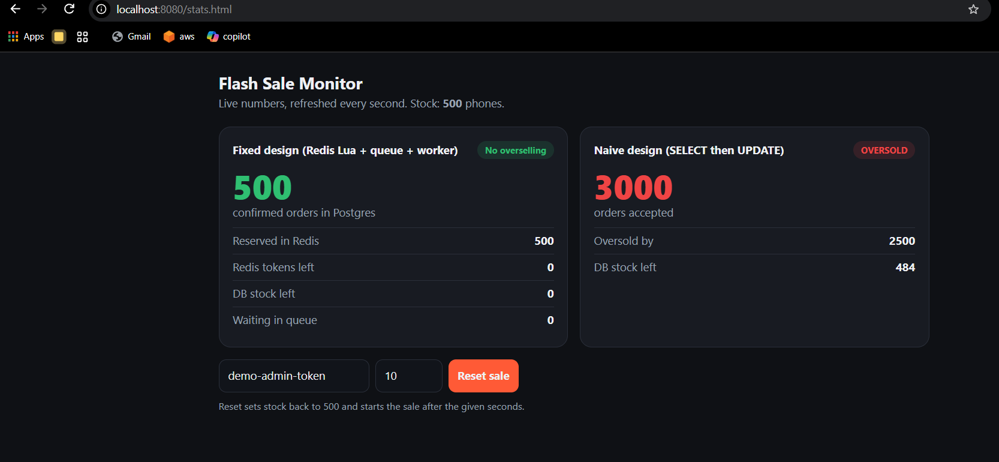
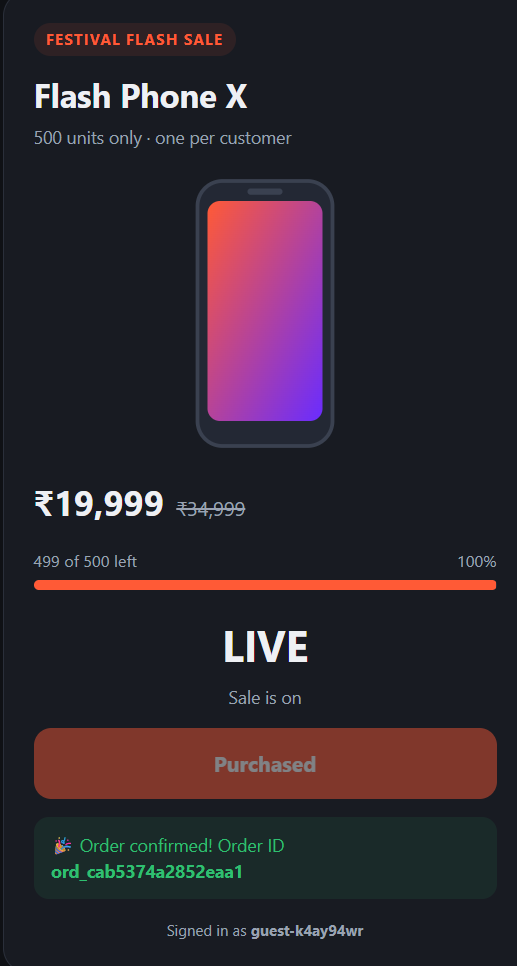

# Flash Sale System: 500 phones, 100k requests, zero overselling

A re-architected checkout for a festival flash sale. The original design sold **540 phones when only 500 existed**. This version sells **exactly 500**, answers every request in milliseconds, and keeps the database out of the request path.

**Stack:** Go · Redis (Lua + Streams) · PostgreSQL · NGINX / AWS Application Load Balancer · Docker · k6

## How it works

```
 Browser ──► NGINX / AWS ALB ──► Go API x3 (stateless) ──► Redis
 (click lock,  (rate limit,        │                         │ 1 Lua script, atomic:
  polling)      bot block,         │ 202 Accepted            │  check stock → take token
                load balance)      │ + tracking URL          │  → mark buyer → enqueue
                                   ▼                         ▼
                              Browser polls            Redis Stream (queue)
                              /api/orders/{id}               │
                                                             ▼
                                                   Go workers ──► PostgreSQL
                                                   UPDATE ... WHERE stock > 0
                                                   (one transaction per order)
```

1. **Click** → the button locks on the first click, so one user sends one request.
2. **NGINX / ALB** blocks bots, rate-limits per IP, and spreads load over the API servers.
3. **API** runs one **Lua script inside Redis**: if stock > 0 and this user hasn't bought, take a token and push the order onto a queue. Redis runs scripts one at a time, so two requests can never both take the last phone.
4. API replies **202 Accepted** with a tracking URL in ~1 ms. **No database call on the hot path.**
5. **Workers** pull orders from the queue and write them to Postgres with `UPDATE inventory SET stock = stock - 1 WHERE product_id = $1 AND stock > 0`.
6. The page polls the tracking URL and shows **Confirmed**.

## Run it on Windows (10 minutes)

You need **Docker Desktop** running. Go does **not** need to be installed: Docker compiles it.

```powershell
cd flash-sale-system
docker compose up --build
```

First build takes 3–5 minutes. Then open:

| URL | What |
|---|---|
| http://localhost:8080 | Shop page (sale starts 30s after startup) |
| http://localhost:8080/stats.html | Live monitor + **Reset sale** button |

Stop with `Ctrl+C`, or `docker compose down` (add `-v` to wipe data).

## Prove it: before vs after

In a **second** PowerShell window, from the project folder:

```powershell
# 1. The ORIGINAL broken design (SELECT then UPDATE). Expect MORE than 500 sold.
docker run --rm --network flashsale-net -v "${PWD}/loadtest:/scripts" grafana/k6 run /scripts/naive.js

# 2. The FIXED design. 1,000 users, 20,000 requests. Expect EXACTLY 500 sold.
docker run --rm --network flashsale-net -v "${PWD}/loadtest:/scripts" -e RESET=0 grafana/k6 run /scripts/flash-sale.js
```

Or run both with `.\scripts\demo.ps1`. Keep `stats.html` open while the tests run: the naive panel turns **red (OVERSOLD)**, the fixed panel stays at **500**.

Bigger burst: add `-e VUS=2000 -e REQUESTS=50000` after `run`.

## Project structure

```
cmd/api/main.go          Go API: checkout, order status, stats, naive endpoint, rate limiter
cmd/worker/main.go       Go worker: queue → Postgres, retries, crash recovery
internal/shared/         Redis key names + the atomic Lua reservation script
db/init.sql              Tables + safety constraints (CHECK stock >= 0, UNIQUE user)
frontend/index.html      Shop page: ~10 KB, no framework, click lock, polling, retries
frontend/stats.html      Live monitor and reset
nginx/nginx.conf         Load balancer, bot blocking, rate limiting, static caching
loadtest/                k6 load tests (naive vs fixed)
deploy/aws/              AWS ALB deployment: guide, compose files, EC2 setup script
docs/REPORT.md           Design report (frontend, backend, consistency)
docs/INTERVIEW_QA.md     Questions an interviewer is likely to ask, with answers
```

## API

| Method | Path | Response |
|---|---|---|
| GET | `/api/sale` | Sale status, start time, stock left |
| POST | `/api/checkout` `{"userId":"..."}` | **202** queued + `trackUrl` · **409** sold out · **425** not started · **429** slow down |
| GET | `/api/orders/{id}` | `QUEUED` → `CONFIRMED` |
| POST | `/api/naive/checkout` | The original broken design (for comparison only) |
| GET | `/api/stats` | Counts for the monitor and tests |
| POST | `/api/admin/reset?delay=10` | Reset to 500 (header `X-Admin-Token`) |
| GET | `/healthz` | Health check for the load balancer |

## Results

Measured on a Windows laptop with Docker Desktop:

| Metric | Naive design | Fixed design |
|---|---|---|
| Concurrent users / requests | 300 / 3,000 | **1,000 / 20,000** |
| Phones sold (stock 500) | ❌ 3,000 (oversold by 2,500) | ✅ **exactly 500** |
| Dropped requests | 0% | **0%** |
| p95 latency | 1.59 s | **455 ms** |
| Throughput | 318 req/s | **1,862 req/s** |
| Frontend size | — | **9.7 KB** (≈4 KB gzipped), target < 200 KB |

## Screenshots

| Before vs after (live monitor) | Order confirmed |
|---|---|
|  |  |

| Naive load test (oversold) | Fixed load test (exactly 500) |
|---|---|
|  |  |

## Deploy on AWS

See [`deploy/aws/AWS_DEPLOY.md`](deploy/aws/AWS_DEPLOY.md): two EC2 API servers behind an **Application Load Balancer**, plus one data server.

## Troubleshooting

| Problem | Fix |
|---|---|
| `port is already allocated` | Something uses port 8080. Change `"8080:80"` in `docker-compose.yml` to `"8081:80"` |
| `network flashsale-net not found` | Start the app first (`docker compose up`) |
| Sale never starts | Press **Reset sale** on `stats.html` with delay `0` |
| Everything returns 425 | Sale hasn't started yet; wait for the countdown or reset |
| Changed Go code but nothing changed | `docker compose up --build` |
